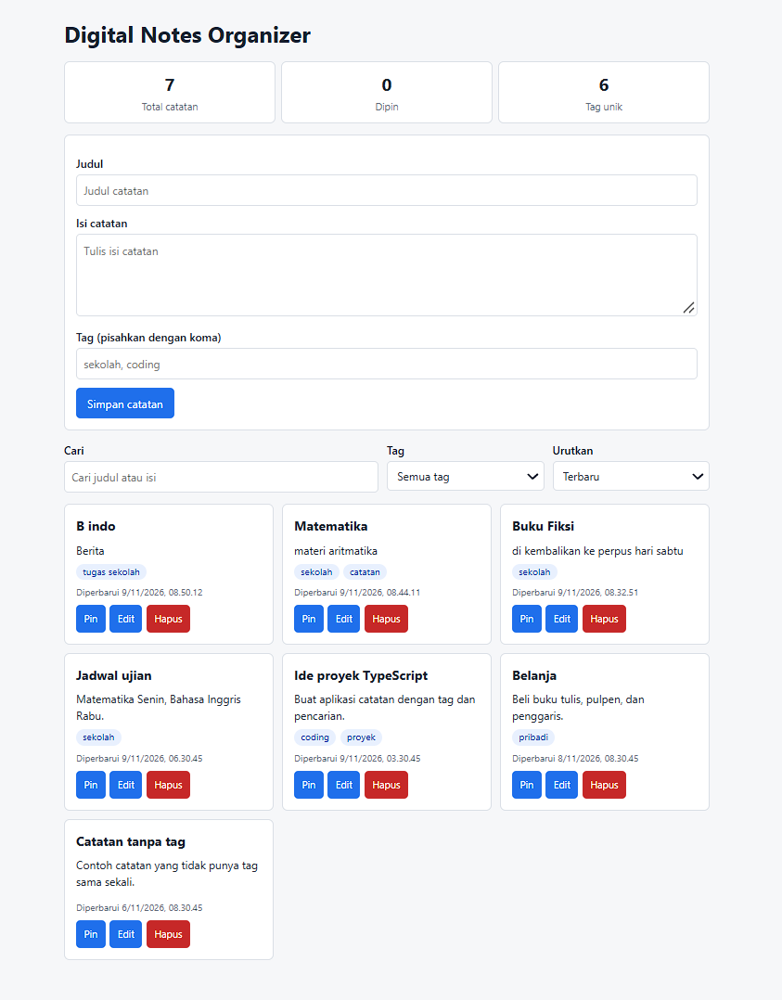
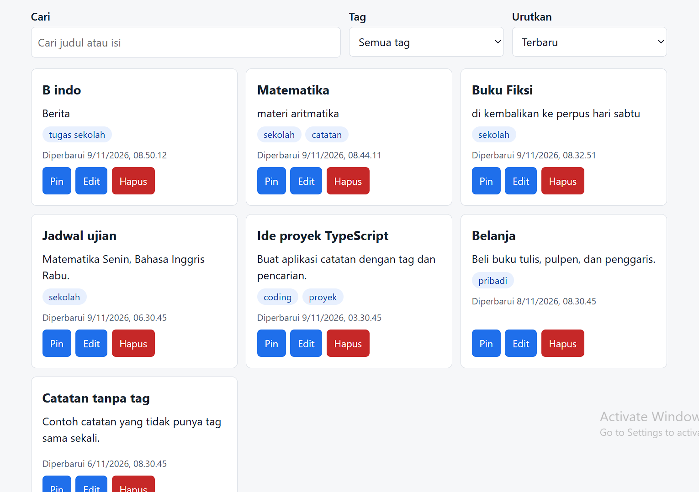
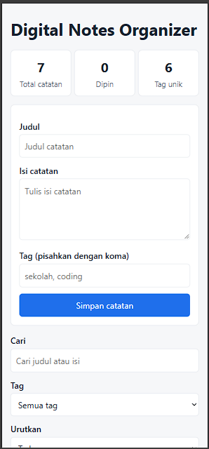

# Digital Notes Organizer - Nomor Absen 18

**Nama:** ISI_Muhammad Ilham
**Kelas:** XI RPL
**Nomor absen:** 18

## Masalah dan tujuan

Siswa sering memiliki banyak catatan dari berbagai mata pelajaran. Kalau tidak diatur, catatan sulit dicari dan catatan penting tenggelam di antara yang lain.

Digital Notes Organizer adalah aplikasi web untuk menulis, mengelompokkan dengan tag, mencari, dan menandai catatan penting. Aplikasi ini berjalan sepenuhnya di browser, tanpa server, dan datanya tersimpan di perangkat pengguna.

## Fitur utama dan fitur khas

**Fitur inti (standar minimum)**

- CRUD: tambah, lihat, edit, dan hapus catatan (hapus dengan konfirmasi).
- Ringkasan otomatis: total catatan, jumlah catatan yang dipin, dan jumlah tag unik. Semuanya dihitung dari data.
- Data tersimpan di `localStorage`, tetap ada setelah halaman di-refresh.
- Validasi input: judul wajib diisi (maksimal 60 karakter) dan isi catatan wajib diisi.
- Keadaan kosong: pesan khusus untuk "belum ada catatan" dan "tidak ada hasil pencarian".
- Alur async: loading simulasi dengan `async/await` dan Promise, lengkap dengan penanganan error.
- Tampilan responsif untuk desktop dan ponsel.

**Fitur khas topik 18**

- Pencarian teks pada judul dan isi catatan (tidak peka huruf besar/kecil).
- Filter berdasarkan tag. Daftar tag dibuat otomatis dari catatan yang ada.
- Pin catatan: catatan yang dipin selalu tampil paling atas.
- Pengurutan: terbaru, terlama, atau judul A-Z.

## Teknologi yang digunakan

- TypeScript (bahasa utama untuk model data, logika, dan validasi)
- Vite (template `vanilla-ts`)
- HTML dan CSS (CSS Grid dan media query untuk responsivitas)
- localStorage sebagai penyimpanan data
- Git dan GitHub

## Cara instalasi dan menjalankan

Prasyarat: Node.js 20.19+ atau 22.12+, serta npm.

```bash
git clone URL_REPOSITORY_KAMU
cd ts-xi-18-notes-organizer
npm install
npm run dev
```

Buka alamat yang muncul di terminal (biasanya `http://localhost:5173/`).

Untuk mengecek build produksi:

```bash
npm run build
```

## Struktur folder

```
index.html
src/
  main.ts                  # menghubungkan UI dengan fungsi service
  style.css
  types/note.ts            # interface dan type alias
  utils/storage.ts         # fungsi baca/tulis localStorage
  services/noteService.ts  # aturan bisnis: CRUD, validasi, filter, statistik
```

## Konsep TypeScript yang diterapkan

| Konsep                                        | Penerapan                                                            |
| --------------------------------------------- | -------------------------------------------------------------------- |
| Interface                                     | `Note`, `NoteFilter`, `NoteStats` di `types/note.ts`                 |
| Type alias dan union/literal type             | `SortOrder = "newest" \| "oldest" \| "title"`                        |
| Utility type                                  | `Pick` untuk `NoteInput`, `Partial` untuk `NoteUpdate`               |
| Properti opsional dan null/undefined handling | `tags?: string[]`, ditangani dengan `n.tags ?? []`                   |
| Generic                                       | `loadFromStorage<T>` dan `saveToStorage<T>`                          |
| Function dengan tipe parameter dan return     | Seluruh fungsi di `noteService.ts`                                   |
| Array method bertipe                          | `filter`, `map`, `flatMap`, `sort`, `includes`                       |
| Module (import/export)                        | Pemisahan `types`, `utils`, `services`, dan `main.ts`                |
| Async/await dan Promise                       | `fetchNotes()` dan `init()` dengan `try/catch/finally`               |
| Type narrowing                                | `e instanceof Error` pada blok `catch`, dan type guard `isSortOrder` |

Fungsi service bersifat immutable: setiap fungsi mengembalikan array baru dan tidak mengubah array asli.

Aplikasi ini tidak memakai `any`.

## Screenshot aplikasi

> Ganti dengan screenshot milikmu sendiri (minimal 3). Simpan di folder `screenshots/`.





## Minimal 5 test case (langkah dan hasil yang diharapkan)

> Jalankan setiap skenario sendiri, lalu isi kolom "Hasil" dengan Berhasil atau Gagal sesuai yang kamu lihat.

| No  | Skenario                 | Langkah                                            | Hasil yang diharapkan                                                     | Hasil |
| --- | ------------------------ | -------------------------------------------------- | ------------------------------------------------------------------------- | ----- |
| 1   | Judul kosong             | Kosongkan judul, isi konten, klik "Simpan catatan" | Muncul pesan "Judul tidak boleh kosong." dan catatan tidak tersimpan      | ISI   |
| 2   | Tambah catatan valid     | Isi judul, isi, dan tag, lalu klik simpan          | Catatan muncul di daftar dan angka total di ringkasan bertambah           | ISI   |
| 3   | Pencarian di isi catatan | Ketik kata yang hanya ada di isi sebuah catatan    | Hanya catatan yang cocok yang tampil                                      | ISI   |
| 4   | Pencarian tanpa hasil    | Ketik kata yang tidak ada di catatan mana pun      | Muncul pesan "Tidak ada catatan yang cocok dengan pencarian atau filter." | ISI   |
| 5   | Pin catatan              | Klik "Pin" pada catatan yang berada di bawah       | Catatan pindah ke paling atas dan jumlah "Dipin" bertambah                | ISI   |
| 6   | Data tetap ada           | Tambah catatan, lalu refresh halaman               | Semua data, termasuk catatan baru, masih ada                              | ISI   |
| 7   | Hapus semua catatan      | Hapus seluruh catatan satu per satu                | Muncul pesan "Belum ada catatan. Tulis catatan pertamamu di atas."        | ISI   |
| 8   | Edit catatan             | Klik "Edit", ubah judul, klik "Perbarui catatan"   | Judul berubah dan waktu "Diperbarui" ikut berubah                         | ISI   |

## Batasan yang diketahui

- Data hanya tersimpan di browser dan perangkat yang sama. Tidak ada sinkronisasi antar perangkat.
- Kalau data browser (localStorage) dihapus, catatan ikut hilang.
- Proses loading hanyalah simulasi (delay 0,8 detik), bukan pengambilan data dari server.
- Belum ada fitur ekspor/impor catatan, format teks kaya (bold, list), dan pengujian otomatis.
- Pencarian hanya mencocokkan teks yang mengandung kata kunci, belum mendukung pencarian mirip (fuzzy).

## Pernyataan penggunaan AI/referensi

Saya menggunakan AI (Claude) untuk: menjelaskan konsep TypeScript, menyusun rencana pengerjaan, dan membuat kerangka kode awal proyek.

Setelah itu saya sendiri: menjalankan dan menguji aplikasi, mempelajari setiap fungsi hingga bisa menjelaskannya, serta menyelesaikan masalah yang muncul selama pengerjaan. Saya bertanggung jawab atas seluruh kode yang dikumpulkan.

Referensi lain: TypeScript Guidebook (https://typescript-guidebook.vercel.app/) dan dokumentasi Vite (https://vite.dev/guide/).
